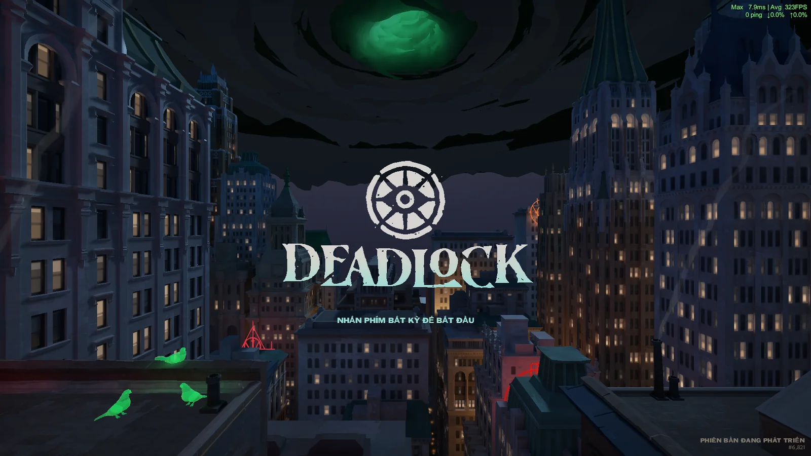
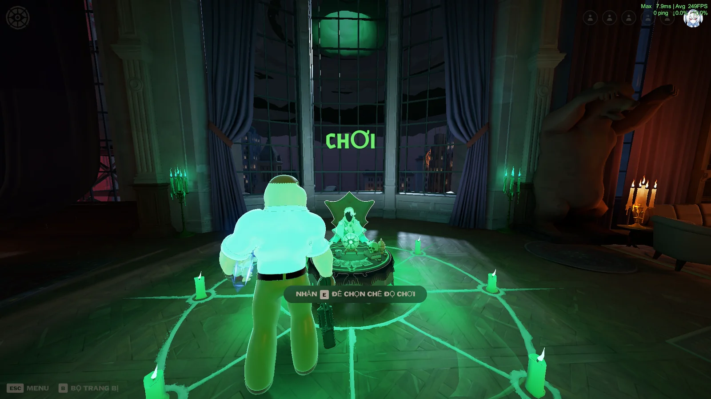
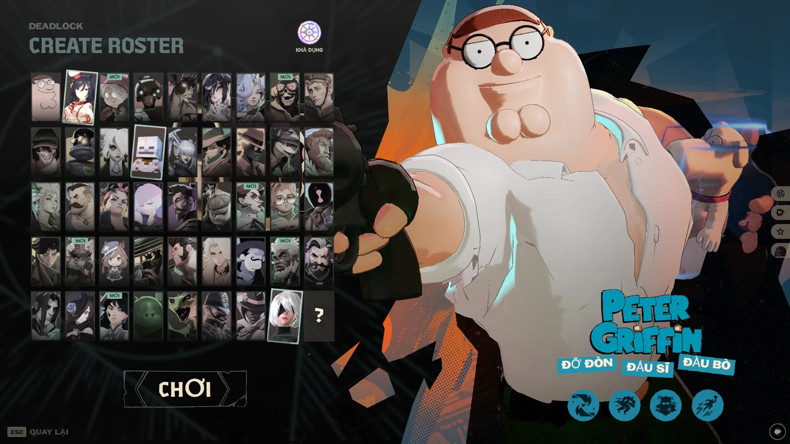
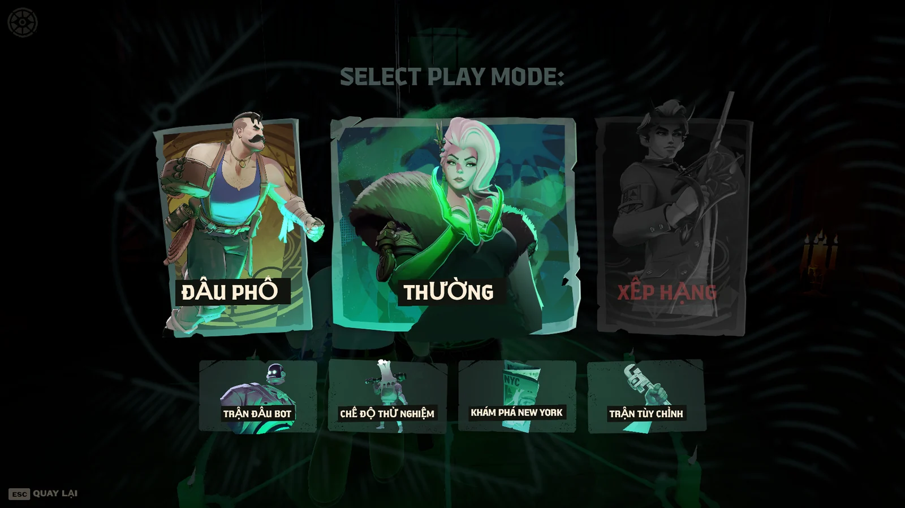
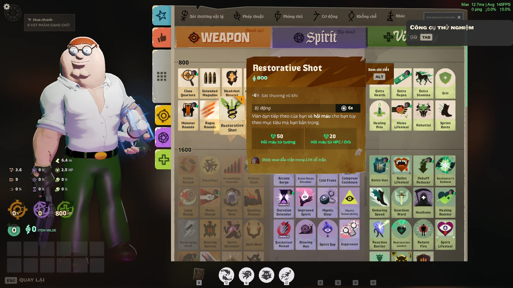
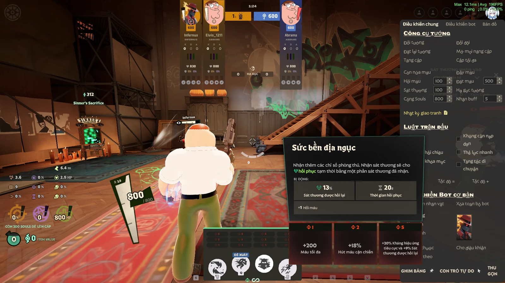

# Deadlock Việt Hóa 🇻🇳

> **Bản Việt hóa cộng đồng dành cho Deadlock tại Việt Nam.** Tập trung vào giao diện, mô tả kỹ năng và vật phẩm, cảnh báo trong trận, phím tắt, chế độ thử nghiệm và thống kê. Cách dịch ưu tiên **tự nhiên, ngắn gọn, dễ đọc khi chơi**, đồng thời giữ lại các tên riêng quan trọng.


## 📷 Hình ảnh trong game

| Màn hình khởi động | Sảnh Hideout |
|:--:|:--:|
|  |  |

| Danh sách chọn tướng | Chọn chế độ chơi |
|:--:|:--:|
|  |  |

| Cửa hàng và mô tả vật phẩm | Sandbox và công cụ thử nghiệm |
|:--:|:--:|
|  |  |

*Ảnh chụp từ bản game đang được Việt hóa. Một số nhãn vẫn còn tiếng Anh do là tên riêng hoặc chưa được rà soát xong.*

## ✨ Nội dung Việt hóa

- **Sảnh và menu:** tìm trận, chọn chế độ chơi, chọn tướng, một phần thông báo hệ thống và giao diện cài đặt.
- **Trong trận:** cảnh báo, hướng dẫn thao tác và hotkey (nâng kỹ năng, di chuyển, Zipline, tương tác, ping, v.v.).
- **Tướng và kỹ năng:** mô tả, hiệu ứng, thông số và cách dùng kỹ năng; giữ nguyên tên tướng và tên kỹ năng riêng.
- **Vật phẩm và cửa hàng:** mô tả công dụng, chỉ số, hướng dẫn mua; giữ tên item để dễ tra cứu build.
- **Hồ sơ và thống kê:** lịch sử trận, số trận thắng/thua, hạ gục, hỗ trợ và các số liệu khác.
- **Sandbox / Hero Testing / Replay:** nút điều khiển, công cụ thử nghiệm, xem trận và camera.

### Các thuật ngữ được giữ nguyên

**Souls**, **Rift**, **Unstable Rift**, **Soul Urn**, **Guardian**, **Base Guardian**, **Walker**, **Shrine**, **Patron**, tên tướng, tên item, tên kỹ năng riêng và các tên buff/debuff quan trọng.

Ví dụ: `Souls thu được`, `Bảo vệ Guardian`, `Unstable Rift xuất hiện`. Không đổi Souls thành “Linh hồn” hay đổi tên item sang tiếng Việt.

## 📥 Cài đặt bản Việt hóa


Tải gói bản Việt hóa của dự án, giải nén và sao chép **thư mục `localization`** vào:

```text
<SteamLibrary>/steamapps/common/Deadlock/game/citadel/resource/
```

Ví dụ với Steam cài ở ổ C:

```text
C:\SteamLibrary\steamapps\common\Deadlock\game\citadel\resource\
```

Chọn **Replace the files in the destination** khi Windows hỏi có ghi đè hay không.


## 🧰 Khắc phục sự cố

| Hiện tượng | Cách xử lý |
|---|---|
| Game vẫn hiển thị tiếng Anh | Kiểm tra đường dẫn `game/citadel/resource/localization`, xác nhận các file `_english.txt` đã được ghi đè và game đang để English. |
| Mất bản dịch sau khi cập nhật game | Bản cập nhật hoặc **Verify integrity of game files** có thể ghi đè file đã chỉnh; hãy cài lại bản dịch tương thích. |
| Chữ đè lên nhau / khó đọc | Thử bản dịch rút gọn, hoặc font Radiance tùy chọn; không phải mọi lỗi bố cục đều do font. |
| Một số dòng chưa được dịch | Gửi ảnh chụp, chuỗi tiếng Anh gốc và vị trí xuất hiện để rà đúng khóa ngôn ngữ. |
| Muốn trở về tiếng Anh gốc | Khôi phục các bản sao lưu hoặc dùng chức năng Verify integrity trong Steam. |

## 🚧 Tình trạng và giới hạn

- **Chưa phải bản Việt hóa 100%.** Một số chuỗi mới hoặc hiếm gặp vẫn còn tiếng Anh.
- **Không Việt hóa voice-line của tướng** theo phạm vi dự án hiện tại.
- Tên riêng và các thuật ngữ gameplay quan trọng được giữ nguyên có chủ đích.
- Chưa thể bảo đảm mọi bản cập nhật Deadlock đều tương thích mà không cần chỉnh lại file.

## 🤝 Đóng góp / Báo lỗi

Bạn có thể tạo **GitHub Issue** khi thấy lỗi dịch, sai ngữ cảnh, tràn chữ hoặc một câu còn tiếng Anh. Nên đính kèm:

1. Ảnh chụp trong game và vị trí xuất hiện (ví dụ: Hideout, HUD, Sandbox, Shop, Profile).
2. Chuỗi tiếng Anh và câu dịch đang hiển thị (nếu có).
3. Phiên bản hoặc ngày cập nhật game và các bước để tái hiện lỗi.

Khi chỉnh file dịch, **không đổi tên khóa ngôn ngữ**, không xóa các biến như `{g:...}`, `{s:...}`, `%s1` và các thẻ định dạng như `<span>`, `<br>`; kiểm tra cả độ dài câu trong HUD.

## 📂 Cấu trúc thư mục GitHub đề xuất

```text
Deadlock-VietHoa/
├── README.md
├── assets/
│   └── screenshots/
│       ├── 01-man-hinh-bat-dau.webp
│       ├── 02-hideout.webp
│       ├── 03-danh-sach-tuong.webp
│       ├── 04-che-do-choi.webp
│       ├── 05-cua-hang.webp
│       └── 06-sandbox.webp
└── localization/                  # Chép từ gói bản Việt hóa, nếu bạn phân phối các file này
    ├── citadel_main/
    ├── citadel_heroes/
    ├── citadel_mods/
    ├── citadel_attributes/
    └── citadel_gc/
```

> **Lưu ý khi công khai:** kiểm tra quyền chia sẻ các tệp bản địa hóa lấy từ game. Hình ảnh, logo, nhân vật và tài sản Deadlock thuộc chủ sở hữu tương ứng. Các hình minh họa trong README chỉ dùng để giới thiệu dự án fan-made.

---

**Deadlock Việt Hóa** — Dịch để chơi dễ hiểu hơn, giữ nguyên những thuật ngữ quan trọng của game.
